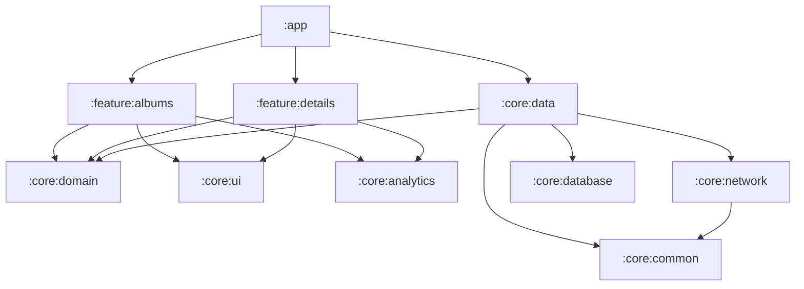

# Albums — test technique Android Leboncoin

Application Android native qui affiche le catalogue
[`technical-test.json`](https://static.leboncoin.fr/img/shared/technical-test.json) (5 000 entrées) :
liste paginée, écran de détail, favoris persistés et fonctionnement hors ligne.

> Énoncé d'origine : [leboncoin/android-technical-test](https://github.com/leboncoin/android-technical-test).
> L'historique Git est découpé en commits atomiques : les corrections de bugs du code existant
> viennent **avant** la refonte, pour que chaque piège et sa correction se lisent séparément.

## Sommaire

1. [Lancer le projet](#lancer-le-projet)
2. [Fonctionnalités](#fonctionnalités)
3. [Architecture](#architecture)
4. [Patterns appliqués](#patterns-appliqués)
5. [Choix des librairies](#choix-des-librairies)
6. [Bugs et pièges corrigés](#bugs-et-pièges-corrigés)
7. [Performances](#performances)
8. [Tests](#tests)
9. [Limites connues](#limites-connues)
10. [Évolutions](#évolutions) → [ROADMAP.md](ROADMAP.md)

## Lancer le projet

Prérequis : JDK 17 et un SDK Android avec la plateforme 36. Android Studio est le plus simple, mais
pas obligatoire : tout passe par le wrapper Gradle.

```bash
./gradlew assembleDebug          # APK debug : app/build/outputs/apk/debug/app-debug.apk
./gradlew installDebug           # installe sur l'appareil ou l'émulateur connecté (adb)
./gradlew assembleRelease        # APK release minifié par R8 (signé avec la clé debug)
./gradlew testDebugUnitTest      # tous les tests unitaires et UI (JVM / Robolectric)
```

Sans Android Studio, sur un téléphone : activer les *Options pour les développeurs* puis le
*Débogage USB*, brancher le téléphone, puis lancer `./gradlew installDebug` (ou
`adb install app/build/outputs/apk/debug/app-debug.apk`). On peut aussi copier l'APK sur le
téléphone et l'ouvrir (autoriser les sources inconnues).

## Fonctionnalités

| Besoin de l'énoncé | Réalisation |
|---|---|
| Liste des albums | Liste paginée (Paging 3 sur Room), pull-to-refresh, états chargement / vide / erreur |
| Persistance hors ligne, même après redémarrage | Room = source de vérité unique ; le réseau ne fait que mettre à jour le cache. Les images vues restent en cache disque (Coil). |
| Favoris persistés en local | Table Room dédiée, bouton cœur sur la liste et le détail, filtre « Favoris » |
| Écran de détail | Image grand format (la miniature déjà en mémoire sert de placeholder), titre, n° d'album et de titre, favori |
| Changements de configuration | État dans des `ViewModel` (`StateFlow`), pages mises en cache dans le `viewModelScope`, filtre sauvegardé dans `SavedStateHandle` (survit aussi à la mort du process) |
| Injection de dépendances | Hilt |
| Multi-modules | 11 modules, voir ci-dessous |

Bonus : thème sombre (palette Spark), textes en anglais et en français, retour prédictif, accessibilité
(descriptions des icônes, éléments décoratifs non annoncés).

## Architecture

Architecture en couches recommandée par Google (UI → domaine → données), découpée en modules
**core** (techniques, réutilisables) et **feature** (un écran autonome chacun).



| Module | Rôle |
|---|---|
| `:app` | Assemble l'application : graphe Hilt, graphe de navigation, thème. Ne contient aucune logique métier. |
| `:feature:albums` | Écran liste : `AlbumsViewModel`, écran Compose, route de navigation. |
| `:feature:details` | Écran détail : `AlbumDetailViewModel`, écran Compose, route de navigation. |
| `:core:domain` | **Kotlin pur** : modèle `Album`, erreurs du domaine, contrat `AlbumRepository`. |
| `:core:data` | `OfflineFirstAlbumRepository` : synchronise le réseau dans la base et expose la base. |
| `:core:database` | Room : entités, DAO, requêtes paginées, schéma exporté. |
| `:core:network` | Retrofit, OkHttp, Coil `ImageLoader`, DTO réseau. |
| `:core:analytics` | Interface `AnalyticsHelper`, indépendante de tout SDK. |
| `:core:ui` | Briques Compose partagées construites sur Spark (image, bouton favori, états). |
| `:core:common` | Dispatchers de coroutines injectables. |
| `:core:testing` | Fakes et règles JUnit partagés par les tests de tous les modules. |

Règles de dépendance :

- **Les features ne dépendent que des contrats** (`:core:domain`), jamais de `:core:data`. Elles ne
  connaissent ni Retrofit ni Room, et une modification de la couche données ne les recompile pas.
- **Les features ne se connaissent pas.** Chacune expose une route et des callbacks
  (`onAlbumClick: (Int) -> Unit`) ; c'est `:app` qui décide où mène chaque action.
- **`:core:domain` est un module JVM** : il compile et se teste sans le framework Android.
- La configuration Gradle est mutualisée dans des **convention plugins** (`build-logic/`) :
  chaque module déclare ce qu'il *est* (`leboncoin.android.feature`, `leboncoin.android.room`…)
  au lieu de recopier SDK, cibles Java/Kotlin et configuration Compose.

### Flux de données

```
            refresh()                     observe (Flow / PagingData)
Réseau ──────────────► Room (source de vérité) ──────────────► ViewModel ──► UI Compose
                            ▲                                      │
                            └────────── setFavorite() ─────────────┘
```

L'UI n'observe **que** la base. Un refresh réussi remplace le cache dans une transaction
(les observateurs ne voient jamais d'état vide intermédiaire) ; un refresh en échec n'efface
rien. Les favoris sont dans une table séparée : remplacer le cache ne les touche jamais.

## Patterns appliqués

- **Offline-first / Single Source of Truth** : la base est la seule source exposée à l'UI.
- **Repository** (contrat dans le domaine, implémentation dans la couche données) et
  **inversion de dépendances** via `@Binds` Hilt.
- **MVVM + flux de données unidirectionnel** : le `ViewModel` expose un état immuable
  (`StateFlow<UiState>`), l'UI remonte des événements (`onFavoriteClick`…).
- **Composables stateful / stateless** : `AlbumsScreen(viewModel)` collecte l'état,
  `AlbumsScreen(uiState, …)` l'affiche seulement. L'écran se teste et se prévisualise sans Hilt.
- **États modélisés explicitement** : `sealed interface AlbumDetailUiState`
  (`Loading` / `Success` / `NotFound`), `RefreshResult` et `DataError` au lieu d'exceptions
  qui traversent les couches.
- **Mappers** entre les modèles réseau (`NetworkAlbum`), base (`AlbumEntity`) et domaine (`Album`) :
  chaque couche peut évoluer sans casser les autres.
- **Injection assistée** pour passer l'id de l'album au `ViewModel` de détail : pas d'API
  Bundle/navigation dans le `ViewModel`.
- **Navigation type-safe** (routes `@Serializable`).
- **Convention plugins Gradle** et **version catalog** unique.

## Choix des librairies

| Besoin | Choix | Pourquoi |
|---|---|---|
| UI | Jetpack Compose + **Spark** | Spark est le design system d'Adevinta/Leboncoin, déjà présent dans le projet : cohérence visuelle et composants accessibles. |
| DI | **Hilt** | Standard Android, vérifie le graphe **à la compilation**, intégré aux `ViewModel` et à la navigation. Utilisé avec KSP (plus rapide que kapt). |
| Persistance | **Room** | Requêtes SQL vérifiées à la compilation, `Flow` et `PagingSource` générés, migrations testables grâce au schéma exporté. DataStore ne convient pas à 5 000 lignes relationnelles. |
| Pagination | **Paging 3** | Ne charge en mémoire que les pages visibles d'une liste de 5 000 éléments, s'intègre directement à Room et à `LazyColumn`. |
| Réseau | **Retrofit 3 + OkHttp 5** | Déjà dans le projet, standard. Passage au convertisseur kotlinx.serialization **officiel** de Retrofit 3 (celui de Jake Wharton est déprécié). |
| Sérialisation | **kotlinx.serialization** | Sans réflexion (compatible R8 sans règles), multiplateforme. |
| Images | **Coil 3** | Pensé pour Compose et les coroutines, cache mémoire + disque, partage le client OkHttp de l'app. |
| Navigation | **Navigation Compose** (routes type-safe) | Solution officielle, gère le back stack, la restauration d'état et les arguments typés. |
| Asynchronisme | **Coroutines / Flow** | Standard Kotlin, annulation structurée liée au `viewModelScope`. |
| Tests | JUnit4, kotlinx-coroutines-test, **Turbine**, **Robolectric**, MockWebServer, paging-testing | Tous les tests tournent sur la JVM, sans émulateur, donc vite et en CI. |
| Fuites mémoire | LeakCanary (debug) | Déjà présent, il a révélé la fuite de l'`AnalyticsHelper`. |

Choix volontairement **non** faits :

- **Pas de use cases** : aucune règle métier ne justifie aujourd'hui une classe qui ne ferait que
  déléguer au repository. Ils seront ajoutés quand une logique combinera plusieurs sources
  (voir la roadmap).
- **Pas de librairie de mock** : des fakes écrits à la main (`FakeAlbumRepository`) testent un
  comportement réel et résistent mieux aux refactorings que des mocks d'appels.
- **Pas de `RemoteMediator`** : l'API renvoie tout le catalogue en une requête, elle n'est pas
  paginée côté serveur. Un `RemoteMediator` n'apporterait que de la complexité.

## Bugs et pièges corrigés

Chaque correction a son propre commit (`git log --oneline`).

| # | Problème dans le code d'origine | Conséquence | Correction |
|---|---|---|---|
| 1 | `compileSdk 35` alors que `activity 1.11` et `core-ktx 1.17` exigent 36 ; `kotlinOptions` déprécié | **Le projet ne compilait pas** | compileSdk/targetSdk 36, AGP 8.13, Gradle 8.14, `compilerOptions` |
| 2 | `DetailsActivity` exportée avec un intent-filter `MAIN/LAUNCHER` | Deux icônes dans le launcher ; écran ouvrable par n'importe quelle app | Activité interne, puis remplacée par une destination de navigation |
| 3 | `if (!BuildConfig.DEBUG)` autour du logging HTTP | Corps des requêtes loggés **en production** (fuite de données, ~1 Mo de log par appel) et rien en debug | Condition corrigée, logging limité aux appels API (jamais aux images) |
| 4 | `GlobalScope.launch` dans le `ViewModel` | Requêtes jamais annulées, fuite du `ViewModel` | `viewModelScope` |
| 5 | `MutableSharedFlow` sans replay | Liste **perdue à chaque rotation** (rien n'est rejoué au nouvel abonné) | `StateFlow` |
| 6 | Chargement dans `LaunchedEffect(Unit)` | Nouvel appel réseau à chaque rotation | Chargement dans `init` du `ViewModel` |
| 7 | `catch (e: Exception)` vide | Erreurs invisibles pour l'utilisateur ; `CancellationException` avalée (casse la concurrence structurée) | Erreurs typées affichées (snackbar ou plein écran avec « Réessayer ») ; `CancellationException` relancée |
| 8 | `AnalyticsHelper` singleton gardant l'`Activity` reçue | **Fuite mémoire** de chaque activité détruite (détectée par LeakCanary) | D'abord `applicationContext`, puis interface sans aucun `Context` |
| 9 | `trackScreenView` dans `onCreate` | Vue d'écran comptée à chaque rotation | Tracking dans `init` du `ViewModel` |
| 10 | `modifier` du composable réutilisé sur l'image enfant | Les modifiers de l'appelant (taille, padding) appliqués deux fois | `Modifier` neuf pour les enfants |
| 11 | `ChipTinted` pour afficher les numéros d'album/titre | Les chips ont un `onClick = {}` implicite : annoncées comme **boutons** par TalkBack, et elles **interceptent les clics** sur la carte | Remplacées par des `TagTinted` (non interactifs) ; trouvé grâce à un test UI |
| 12 | `Factory` du `ViewModel` ignorant la classe demandée | Cast aveugle | Supprimée au profit de Hilt |
| 13 | Test unitaire qui ne compilait pas (mauvais constructeur, `.value` sur un `SharedFlow`) | Aucun test exécutable | Réécrit, puis remplacé par la nouvelle suite |
| 14 | Release sans R8, dépendance `dependencies {}` placée dans `android {}`, dépendances implicites (lifecycle-compose via Spark) | APK lourd, build fragile | R8 + shrink des ressources (24,7 Mo → 2,5 Mo), dépendances explicites |
| 15 | `ImageRequest` reconstruite à chaque recomposition, en-tête User-Agent ajouté image par image | Allocations inutiles pendant le scroll | Requête `remember`, User-Agent posé une seule fois par un intercepteur OkHttp |

## Performances

- **Pagination** : seules les pages visibles (50 éléments) sont chargées depuis Room.
- **Clés stables et `contentType`** dans la `LazyColumn` : position de scroll conservée et
  compositions recyclées lors des mises à jour (ex. ajout d'un favori).
- **Configuration de stabilité Compose** (`compose_stability.conf`) : les modèles du domaine,
  compilés hors Compose, sont déclarés stables pour que les recompositions soient évitées.
- **Statut favori calculé en SQL** (`EXISTS`) plutôt qu'en mémoire.
- **Un seul client OkHttp** pour l'API et les images (un seul pool de connexions), créé à la
  première requête, en dehors du thread principal (`dagger.Lazy`).
- **Cache images** mémoire + disque ; la miniature déjà affichée sert de placeholder au détail.
- Mapping des 5 000 entrées sur `Dispatchers.Default` ; remplacement du cache en **une seule transaction**.
- **R8** en release.

## Tests

`./gradlew testDebugUnitTest` lance **34 tests**, tous sur la JVM :

| Module | Tests |
|---|---|
| `:core:network` | Parsing du JSON réel (champs inconnus ignorés), propagation des erreurs HTTP — MockWebServer |
| `:core:database` | Tri, statut favori, filtre favoris, `replaceAll` qui conserve les favoris — Room en mémoire (Robolectric) |
| `:core:data` | Refresh, cache conservé hors ligne, mapping des erreurs, favoris qui survivent au refresh |
| `:feature:albums` | `ViewModel` (refresh, refresh concurrents ignorés, erreurs, filtre et `SavedStateHandle`, favoris, analytics) + tests UI Compose |
| `:feature:details` | `ViewModel` (Turbine) + tests UI Compose |

## Limites connues

- L'application a été compilée et testée (tests unitaires et UI Robolectric), mais je ne l'ai pas
  testée manuellement sur un émulateur dans cet environnement.
- Pas encore de tests instrumentés (navigation de bout en bout, migrations Room) : ils sont
  prévus dans la roadmap, avec une CI qui les exécute.
- Le refresh se fait à chaque ouverture de l'écran ; une politique de fraîcheur (ETag/TTL)
  est prévue dans la roadmap.

## Évolutions

La planification des évolutions (bonus de l'énoncé) est détaillée dans **[ROADMAP.md](ROADMAP.md)**.
