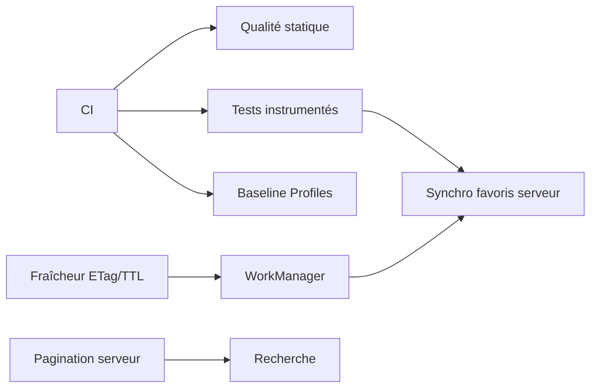

# Roadmap

Comment je ferais évoluer l'application, par ordre de priorité. Chaque étape est livrable
seule et s'appuie sur l'architecture actuelle sans la remettre en cause.

## Principes

- **Livrer par petites étapes réversibles**, derrière des feature flags quand le risque est réel.
- **Mesurer avant d'optimiser** : métriques de performance et de stabilité en production
  avant tout chantier d'optimisation.
- **Pas de nouvelle abstraction sans un besoin concret** (ex. les use cases arrivent avec la
  première règle métier qui combine plusieurs sources).

## Court terme : fiabiliser (1 à 2 sprints)

| Évolution | Pourquoi | Comment |
|---|---|---|
| **CI** (GitHub Actions) | Aucune régression ne doit arriver sur la branche principale | `testDebugUnitTest`, `lint`, `assembleRelease` sur chaque PR ; cache Gradle |
| **Qualité statique** | Style homogène, revues centrées sur le fond | ktlint/Spotless + detekt, ajoutés via un convention plugin ; Android Lint en mode erreur |
| **Tests instrumentés** | Couvrir ce que la JVM ne voit pas | Navigation de bout en bout avec `HiltAndroidTest` + Room de test ; test de migration Room à partir des schémas exportés |
| **Crash reporting + vraie analytics** | Piloter la qualité en production | Implémentations de `AnalyticsHelper` (Firebase, Amplitude…) dans `:core:analytics` ; aucune feature ne change |
| **Signature release** | Publier sur le Play Store | Keystore dans les secrets de la CI, `signingConfig` injectée par variables d'environnement |

## Moyen terme : performance et fraîcheur des données (2 à 4 sprints)

| Évolution | Pourquoi | Comment |
|---|---|---|
| **Politique de fraîcheur** | Ne pas re-télécharger 1 Mo à chaque ouverture | Stocker la date de dernière synchro (DataStore) ; requêtes conditionnelles `ETag` / `If-None-Match` → `304` sans payload ; TTL configurable |
| **Synchronisation en arrière-plan** | Données à jour à l'ouverture, même hors ligne au lancement | `WorkManager` (périodique, contrainte réseau non mesuré), qui appelle le même `AlbumRepository.refresh()` |
| **Baseline Profiles + Macrobenchmark** | Démarrage et scroll plus fluides | Module `:benchmark` ; profils générés en CI ; suivi des métriques de démarrage et de jank |
| **Pagination serveur** | Le catalogue grossira bien au-delà de 5 000 entrées | Avec une API paginée, ajouter un `RemoteMediator` dans `:core:data` ; le contrat `Flow<PagingData<Album>>` ne change pas, donc les features non plus |
| **Recherche** | Retrouver un album parmi des milliers | Table FTS4 Room sur les titres ; nouvelle méthode `search(query)` dans le repository ; debounce dans le `ViewModel` |

## Long terme : produit et plateforme

| Évolution | Pourquoi | Comment |
|---|---|---|
| **Synchronisation des favoris côté serveur** | Retrouver ses favoris sur tous ses appareils | La table `favorites` gagne un statut de synchro (`pending_add` / `pending_remove`) ; un worker pousse les changements (pattern outbox) ; la résolution des conflits devient une vraie règle métier → premiers **use cases** dans `:core:domain` |
| **Écrans adaptatifs** | Tablettes et pliables | Layout liste-détail (`ListDetailPaneScaffold`) ; les deux features existantes sont réutilisées telles quelles |
| **Deep links** | Partage d'un album, notifications | Déclarer un `deepLink` sur `AlbumDetailRoute` ; l'écran gère déjà le cas `NotFound` |
| **Modularisation à l'échelle** | Équipes plus nombreuses | Séparer chaque feature en `:api` (routes) et `:impl` ; graphe de modules vérifié en CI (ex. plugin `dependency-analysis`) |
| **Kotlin Multiplatform** | Partager la logique avec iOS | `:core:domain` est déjà en Kotlin pur ; Room, Paging, kotlinx.serialization et les coroutines sont compatibles KMP, donc `:core:data`, `:core:database` et `:core:network` (avec Ktor) peuvent suivre |

## Ordre de dépendance

